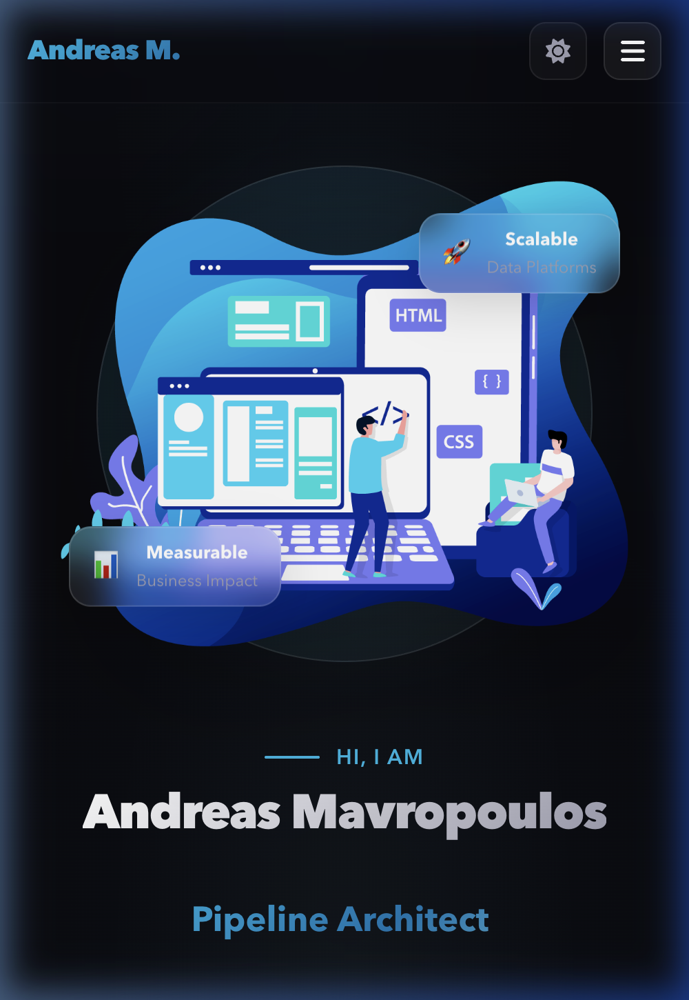
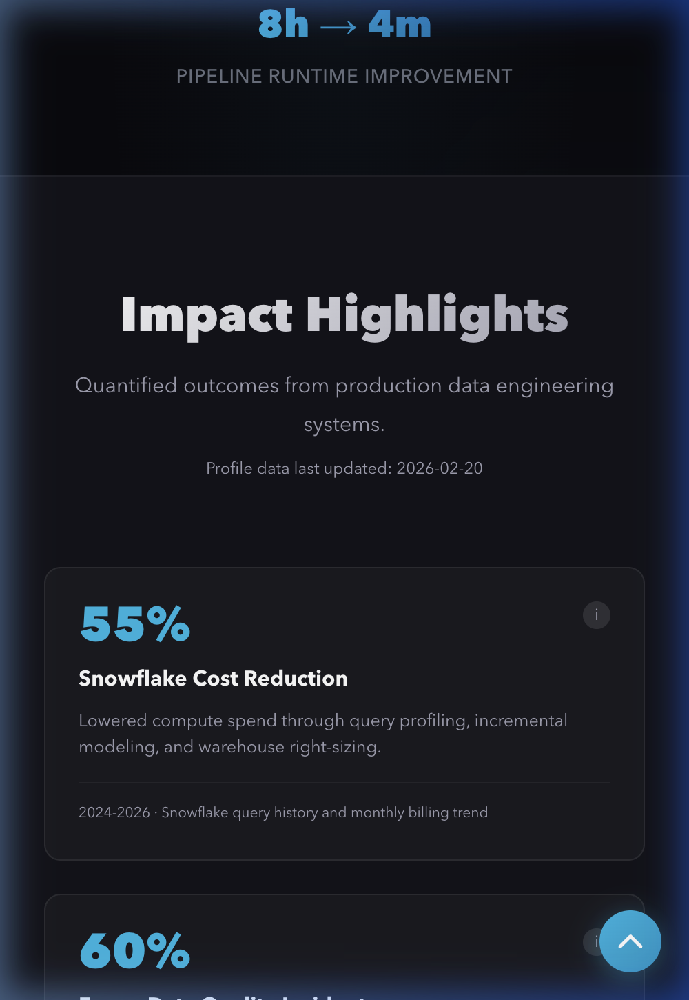
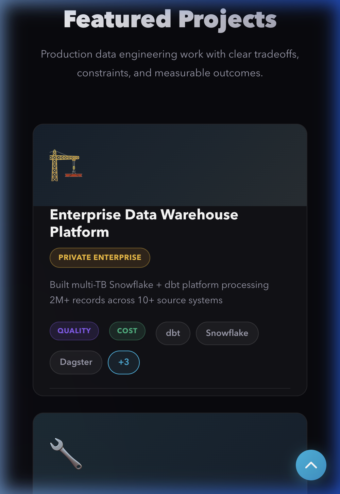
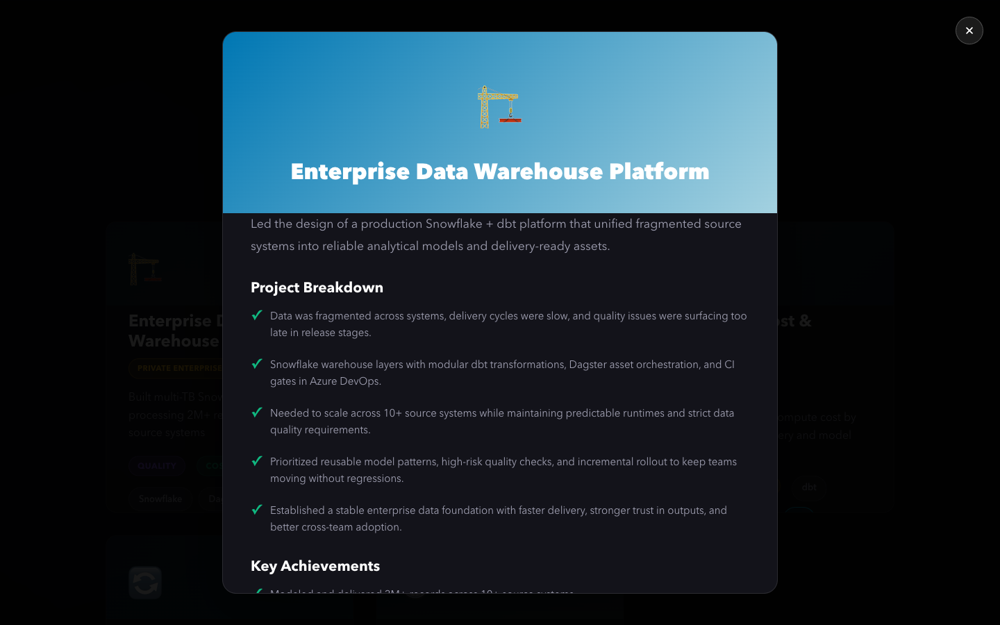

<div align="center">
  

  # 🚀 Andreas Mavropoulos | Data Engineer Portfolio
  
  <p><strong>A modern, responsive portfolio website highlighting enterprise-scale Data Engineering.</strong></p>

  <p>
    <a href="https://adrikosm.github.io/Portfolio/"></a>
    <a href="https://reactjs.org/"></a>
    <a href="https://tailwindcss.com/"></a>
  </p>
</div>

---

## ✨ Professional Snapshot

Designed to validate senior-level hiring signals, this portfolio documents my production outcomes across leading data infrastructure platforms.

- **Role:** Data Engineer at Alpha FMC (Frankfurt, Germany)
- **Scope:** Multi-TB Snowflake warehouse with dbt + Dagster across 10+ source systems
- **Scale:** 2M+ records in active pipelines and streaming throughput up to 50K events/min
- **Impact:** 55% Snowflake cost reduction, 60% fewer data-quality incidents, 8h to 4m runtime optimization
- **Delivery:** CI/CD quality gates, migration automation (4h -> 7m), robust observability and documentation

<br>

<div align="center">
  
  
  <p float="left">
    
    
  </p>
</div>

---

## 🛠 Tech Stack (Portfolio App)

This application is built with a focus on component reusability, modular CSS, and smooth animations.

| Category | Technology |
| :--- | :--- |
| **Framework** | React 18 |
| **Styling** | Vanilla CSS with Custom Properties (CSS variables) |
| **Animations** | Framer Motion 11 |
| **Icons** | FontAwesome 6 |
| **Build Tool** | Create React App (react-scripts 5) |

*(Note: The actual Data Engineering stack highlighted throughout the site includes Snowflake, dbt, Dagster, Kafka, Spark, Azure, and Python.)*

---

## 🚀 Local Setup Guide

Follow these steps to run the portfolio locally on your machine.

### Prerequisites
- [Node.js](https://nodejs.org/) (v16.x or higher)
- npm or yarn

### Installation & Run

1. **Clone the repository:**
   ```bash
   git clone https://github.com/adrikosm/Portfolio.git
   ```

2. **Navigate to the project directory:**
   ```bash
   cd Portfolio
   ```

3. **Install dependencies:**
   ```bash
   npm install
   ```

4. **Start the development server:**
   ```bash
   npm start
   ```
   > The app will automatically open at [http://localhost:3000](http://localhost:3000) with hot reloading enabled.

---

## 🏗 Project Structure

The codebase is organized for clean separation of concerns and maintainability.

```text
src/
├── data/                            # Single source of truth (profileData.js)
├── components/
│   ├── about/                       # Hero section with typewriter effect
│   ├── impact/                      # Top-level KPI metrics showcase
│   ├── projects/                    # Detailed featured project case studies
│   ├── header/ & footer/            # Global navigation and layout
│   └── ...                          # Other sections (Experience, Skills, Contact)
├── App.jsx                          # Main routing and global theme context
└── index.css                        # Global CSS variables and core styles
```

### Key Features
- 🌗 **Dark / Light Mode:** Theme persists via `localStorage` (defaults to dark).
- 📱 **Responsive Design:** Mobile-first layout with a smooth slide-in navigation menu.
- ⚡ **Scroll Animations:** Viewport-triggered element reveals using Intersection Observer.
- 📈 **Centralized Data:** All portfolio claims and metrics sit in `src/data/profileData.js` for easy updates.

---

## 📄 License

This project is open-source and available under the [MIT License](LICENSE).
